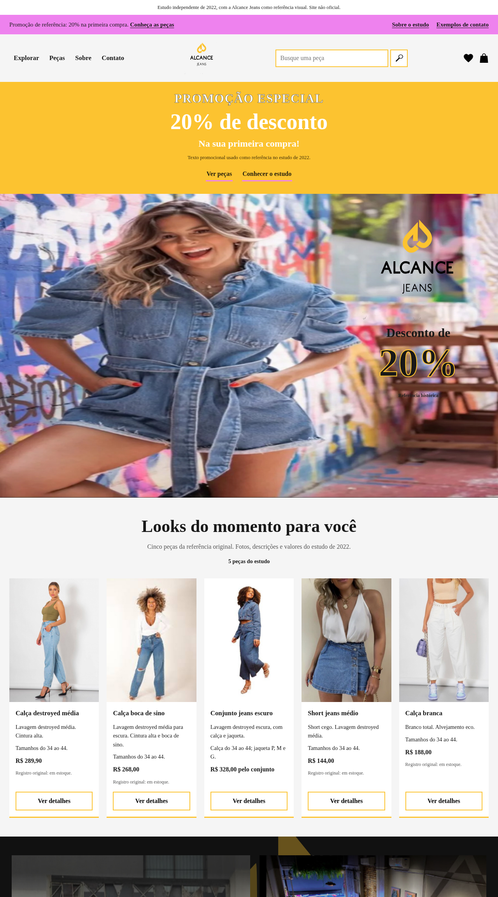
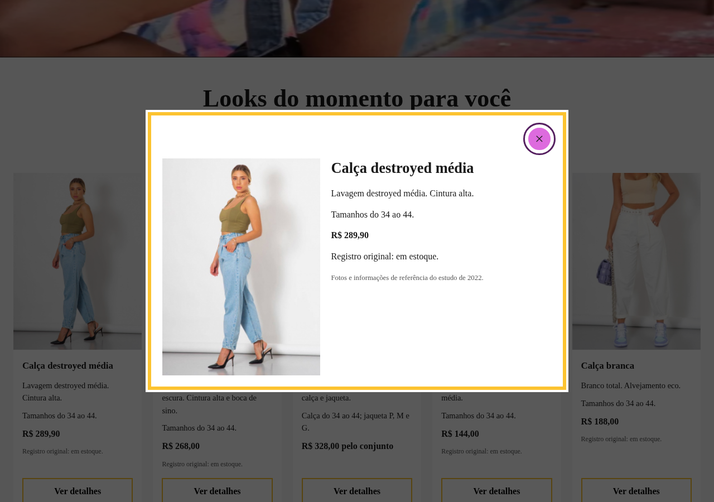

# Fake Alcance Jeans

Uma home de moda criada manualmente como iniciativa pessoal de estudo, registrada em **1 de maio de 2022**, no começo do aprendizado de **Rafael Oliveira Rocha** em desenvolvimento web. A Alcance Jeans foi a referência para a identidade visual, as imagens e os dados das peças. Este é um **estudo independente, não um site oficial da marca**.



## Experimente

Use Python 3 e um navegador moderno com suporte a módulos JavaScript. Na pasta do projeto:

```bash
python3 -m http.server 8000 --bind 127.0.0.1
```

Abra **http://127.0.0.1:8000/**. Não há instalação de dependências ou etapa de build.

1. Explore as cinco peças e busque por **CALCA**: a busca ignora caixa e acentos e mostra quatro resultados, incluindo o conjunto com calça.
2. Experimente **boca de sino** para encontrar uma peça, ou um termo sem correspondência para ver o estado vazio. Use **Limpar** para voltar às cinco.
3. Clique na imagem ou em **Ver detalhes** para abrir a foto, a descrição, os tamanhos e o valor registrado no estudo.
4. Navegue por **Explorar**, conheça a apresentação e use o mouse ou teclado no mapa para mostrar o tooltip.
5. Observe os contadores fictícios e o indicador de horário ilustrativo.

O modal abre pelo teclado, mantém o foco dentro dele, fecha por **Escape**, pelo botão ou pelo fundo e retorna o foco à peça escolhida. A página se adapta também a telas de 375 e 320 px.



## O que funciona

- Busca local nas descrições, com contagem, estado vazio e limpeza.
- Detalhes das cinco peças, sem sair da home.
- Navegação às seções existentes e dropdown com estado acessível.
- Tooltip por mouse e teclado, animação de contadores e indicador baseado no relógio do navegador.

HTML organiza o conteúdo; CSS trabalha hierarquia, alinhamento, grids e responsividade; JavaScript usa módulos, eventos e manipulação do DOM para as interações. Os detalhes são lidos dos próprios cards, sem duplicar um catálogo em outra camada.

## Referências e funcionamento local

Fotos, logotipos, descrições e valores da Alcance Jeans compõem a referência histórica do estudo. Os preços e registros de estoque descrevem aquele material, não uma oferta atual. A marca e as imagens não são apresentadas como criação de Rafael Oliveira Rocha.

Contatos e números dos contadores são fictícios. O horário serve para demonstrar uma regra baseada no relógio local, sem consultar atendimento real. A página não encaminha contatos, envia solicitações ou persiste dados. Não há autenticação, carrinho ou compra.

Os arquivos estão em `index.html`, `css/`, `js/` e `img/`. Para experimentar, altere uma cópia do HTML ou do CSS e recarregue a página. Novos termos podem ser testados diretamente na busca; ela usa os textos presentes nos cinco cards. Sirva a página por HTTP para carregar os módulos JavaScript.
